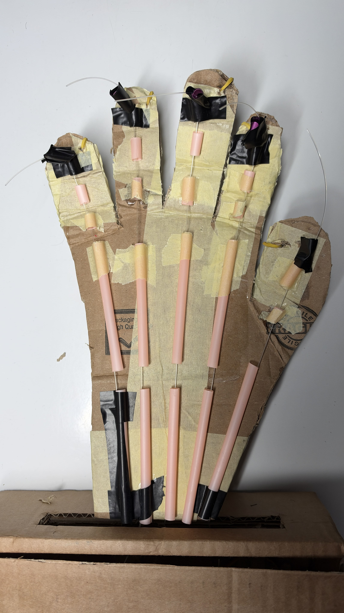
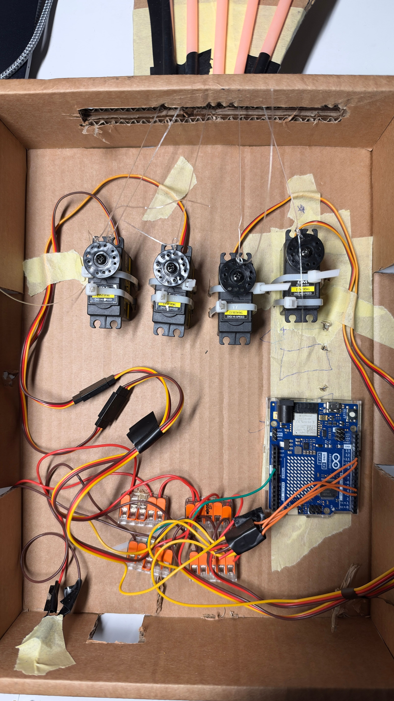

# Webcam-Controlled Robotic Hand
A robotic hand made of cardboard that mirrors my hand in real time, using a webcam. The fingers are able to gradually bend at any position, not only fully open or fully closed.


https://github.com/user-attachments/assets/39c820ec-0817-47a1-b643-cf7e94299bca




## Highlights

- DIY hand made of cardboard, electrical tape, straws and glue
- Proportional control of every finger, which allows them to bend from fully open to fully closed, stopping at any angle
- Calibration made setting two commands: `o` for the open hand, and `c` for the closed hand
- Anti-jitter filter, based on smoothing and deadband
- Custom serial protocol for the Arduino UNO R4, since the current Firmata release (2.5.9) does not support it. 

## How it works


### 1. Hand tracking
OpenCV mirrors every frame and converts the color order from OpenCV's BGR to MediaPipe's RGB.
MediaPipe's Hand Landmarker in `VIDEO` mode uses the previous frame to track the hand, instead of calculating the position from scratch every time.
The model returns 21 landmarks, 1 for the wrist and 4 for each finger.

### 2. Finger curl
Each finger is a chain of 5 landmarks, from the wrist to the finger tip.
For each of the inner joints `b`, it computes the bend angle from the neighbors joints `a` and `c`:

$$\text{bend}(b) = 180^\circ - \angle(\vec{a}-\vec{b},\ \vec{c}-\vec{b})$$

```
    STRAIGHT FINGER                  BENT FINGER

  a ●◄────● b ────►● c              a ●◄────● b
       v1     v2                         v1   │ v2
                                              ▼
                                              ● c
  
  angle = 180°                     angle = 90°
  bend = 0°                        bend = 90°
```

A straight finger has bend = 0° at every joint.
The finger's curl is the sum of its 3 bend angles: the higher it is, the more closed the finger is.

The angles are computed in 3D from the image landmarks scaled to pixels, `(x ⋅ width, y ⋅ height, z ⋅ width)`.

My first attempt was done with MediaPipe's metric world landmarks, but with the palm facing the camera they measured a fist as only 130°-160° of total curl. The scaled image coordinates gave a much wider gap between open and closed hand.

### 3. Calibration

The curl values depend on the person, the camera and the finger (the thumb needs less than the other fingers).
Pressing `o` with an open hand and `c` with a closed hand, the program saves the current 5 curl values of every finger.
Every new measurement is then normalized between 0 (open) and 1 (closed):

$$\text{amount} = \text{clamp}\left(\frac{\text{curl}-\text{curl}_{\text{open}}}{\text{curl}_{\text{closed}}-\text{curl}_{\text{open}}},\ 0,\ 1\right)$$

### 4. Filtering
The landmarks jitter slightly even when the hand is not moving, which would make the servos buzz. I used two filters to fix this:
- Exponential moving average ($\alpha$ = 0.3): `smooth += 0.3 * (amount - smooth)`. Each frame moves 30% of the way towards the new measurement, which absorbs the jitter but still follows the movement.
- Deadband (3°):  a new command is sent to the Arduino only if at least one servo would move by 3° or more. This prevents the servos from twitching around the same position.

If the hand leaves the frame, no command is sent and the robot holds its last position.

### 5. Mapping
The hand has 4 servos for 5 fingers. Thumb, index and middle have their own servo, while ring and pinky fingers share the same servo, which follows the average of the two fingers. 

$$\text{angle}_s = \text{open}_s + \text{amount}_s \cdot (\text{closed}_s - \text{open}_s)$$

Each servo has its own calibrated open and closed angles, and the servo angle is a linear interpolation between them.


### 6. Serial protocol
The current Firmata release (2.5.9) does not support the Arduino UNO R4, so I wrote a text protocol.
Python sends one line per update at 115200 baud, with the four servo angles in a fixed order:

```
thumb,index,middle,ring_pinky\n      e.g. 12,90,150,35
```

The Arduino reads until `\n`, detects three commas, splits it into four numbers and sends them to the servos.
A broken line, for example one half-received at start-up, is ignored.
Every angle is limited to 0°-180° with `constrain`.

The Arduino never replies, because on the UNO R4, messages that nobody reads can fill the USB buffer and freeze the board.

The program is closed commanding `q`, which sends `0,0,0,0`, so the hand opens before the serial port is released. 


## Hardware

The hand is a low-cost prototype that I designed and built myself, to test the control systems before making a 3D-printed version.

### The hand
- The hand is made from a single piece of cardboard, reinforced on the palm
- Each finger has 3 joints, made by folding the cardboard, the folds act as hinges.
- A nylon string runs through pieces of straw glued along the palm side, like a tendon.
- When the servo releases the string, the finger opens again thanks to rubber bands glued to the back of the hand.
- Each string is tied to a round horn on a servo; the four servos are fixed side by side to the frame with zip ties.
- The ring and pinky strings are tied to the same pulley, so the two fingers move together.

### Components

| Part | Details |
|---|---|
| Hand | Cardboard (single piece, reinforced palm), straws, glue, electrical tape |
| Tendons | Nylon string |
| Finger return | Rubber bands on the back of the hand |
| Pulleys | Round horns mounted on the servos |
| Servo mounting | Zip ties on a frame |
| Microcontroller | Arduino UNO R4 WiFi |
| Servos | 4 × diymore 15 kg digital servo |
| Capacitor | 1000 µF capacitor across the servo 5 V and GND lines |
| Power distribution | 4 × Wago lever connectors |
| Servo extensions | 4 × servo extension cables (22 AWG) |
| Power | External 5 V / 8 A supply for the servos, ground shared with the Arduino |
| Camera | Laptop webcam |


### Wiring

| Finger | Arduino pin |
|---|---|
| Thumb | 4 |
| Index | 5 |
| Middle | 12 |
| Ring + Pinky | 11 |


```
  ┌────────┐   USB    ┌──────────────────┐
  │ Laptop ├──────────┤  Arduino UNO R4  │
  └────────┘          │                  │      signal (yellow)
                      │           pin 4 ─┼──────────────────► Servo 1  Thumb
                      │           pin 5 ─┼──────────────────► Servo 2  Index
                      │          pin 12 ─┼──────────────────► Servo 3  Middle
                      │          pin 11 ─┼──────────────────► Servo 4  Ring + Pinky
                      │             GND ─┼───┐
                      └──────────────────┘   │
                                             ▼
  ┌──────────────┐                    ┌───────────┐  brown
  │              │ − ───────────────► │ Wago  GND ├──────────► all 4 servos
  │              │                    └─────┬─────┘
  │  5 V / 8 A   |                          │  − (stripe)
  │    supply    │                         ═══  capacitor
  │              │                         ═══
  │              │                          │  +
  │              │                    ┌─────┴─────┐  red
  │              │ + ───────────────► │ Wago  +5V ├──────────► all 4 servos
  └──────────────┘                    └───────────┘
```



The servos are powered by an external 5 V supply, not by the Arduino’s 5 V pin, which cannot provide enough current for four servos. The supply’s ground is connected to the Arduino’s GND, so the control signals share the same reference.


## Getting started
Follow these steps to run the project on your own computer.

### Requirements
- Software: Python 3.14, Arduino IDE 2.
- Librerie Python: `mediapipe` 1.0.1, `opencv-python`, `pyserial`.
- Hardware: cardboard hand, as shown in the [Hardware](#hardware) section, and a webcam.

### Installation

1. Install the Python libraries:

    ```bash
    pip install mediapipe==1.0.1 opencv-python pyserial
    ```

2. Download the [hand landmarker model](https://storage.googleapis.com/mediapipe-models/hand_landmarker/hand_landmarker/float16/1/hand_landmarker.task) and save it in the same folder as `hand_control.py`, or run:

   ```bash
   curl -L -o hand_landmarker.task https://storage.googleapis.com/mediapipe-models/hand_landmarker/hand_landmarker/float16/1/hand_landmarker.task
   ```

   On Windows PowerShell, type `curl.exe` instead of `curl`. 

3. Upload the Arduino sketch:
   - open `arduino/hand_servos/hand_servos.ino` in the Arduino IDE;
   - select the board in Tools → Board → Arduino UNO R4 WiFi and the port in Tools → Port;
   - click Upload.

4. Close the Serial Monitor in the Arduino IDE, because only one program at a time can use the serial port. If it stays open, Python cannot connect to the Arduino.

### Usage

1. Set the serial port: in `hand_control.py`, change `PORT` to the port of your Arduino. You can find it in the Arduino IDE under Tools → Port.

2. Run the program:

  ```bash
  python hand_control.py
  ```

3. Calibrate: click on the video window, then press `o` with your hand open and `c` with your hand closed.

4. Move your fingers: the robotic hand follows each finger.

5. Press `q` to quit. Before closing, the program sends all servos back to 0°, so the hand opens.

> **No Hardware** → Set `USE_ARDUINO = False` to run only the vision part (the finger bars and the servo angles are shown on the screen)


### Servo calibration

Upload `arduino/servo_calibration/servo_calibration.ino`, open the Serial Monitor at **9600 baud** with **New Line** selected, and type: 

| Command | Action |
|---|---|
| `1 90` | Move servo 1 to 90° (servos 1–4) |
| `+` / `-` | Move the last servo by 2° |
| `off` | Release all servos |


For each servo:

1. Find the angle where the finger is straight and the string is tight: **open angle**.
2. Move towards the closed position with `+` until the finger is closed or the servo starts to strain, then go back by a few degrees: **closed angle**.
3. Copy the values into `SERVO_OPEN` and `SERVO_CLOSED` in `hand_control.py`, in the order thumb, index, middle, ring+pinky.

Close the Serial Monitor before running the Python program.

## Known limitations and future work
The hand works, but it is a first prototype. These are the main limitations, why they happen and how I would fix them.

### 1. Fingers do not close completely
**Problem**: even if the servos hold a 180° angle the fingers are not totally bent.

**Cause**: the length of string a servo can pull depends on its rotation angle and on the pulley radius: 

$$\text{travel} = \theta \cdot r$$

where θ is the rotation in radians and r is the pulley radius.
The servos turn at most 180°, which is not enough string travel with the current pulleys. Widening the pulse range to 500–2500 µs gained only a few degrees, and larger pulleys do not fit because the servos are mounted side by side.

**Fix:**
- larger pulleys mounted at alternating heights, so that neighboring pulleys overlap without touching;
- 270° servos of the same size, which give 50% more travel with the same pulley;


### 2. Ring and pinky move together

**Problem:** the ring and pinky fingers cannot move independently.

**Cause:** the hand has 4 servos for 5 fingers, so these two share one pulley.

**Fix:** use a fifth servo. The serial protocol would extend to: `a,b,c,d,e\n`.

### 3. Depth from a single camera

**Problem:** the measurement is unreliable when fingers point towards the camera or hide each other.

**Cause:** MediaPipe's `z` coordinate is not directly measured, but it is estimated from a 2D image.

**Fix:** to use a second camera to measure the depth.

### 4. Cardboard structure

**Problem:** the cardboard deforms at the folds does not represent correctly the hand movements.

**Cause:** the hand is a low-cost prototype, built to test the control system before investing in a stronger structure.

**Fix:** a 3D-printed version, with proper hinges, channels for the strings and screw-mounted servo brackets.

### 5. No feedback

**Problem:** the system does not know whether a finger actually reached its target, or whether it is pressing against an object.

**Cause:** The robot hand is an open-loop system, where Python sends the angles but receives nothing back.

**Fix:** force sensors (FSRs) on the fingertips, measuring the servo current, or flex sensors along the fingers.


### Future work

1. A 3D-printed hand with staggered pulleys.
2. A fifth servo, to separate the ring and pinky fingers.
3. Fingertip force sensors.


## Credits

- Inspired by [pathofseb/RoboticArm](https://github.com/pathofseb/RoboticArm), which drives the fingers as open/closed only; this project extends it to proportional control.
- Hand tracking: [MediaPipe Hand Landmarker](https://ai.google.dev/edge/mediapipe/solutions/vision/hand_landmarker) by Google.
